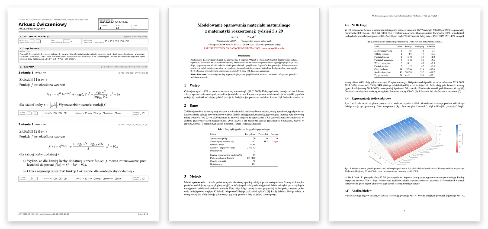
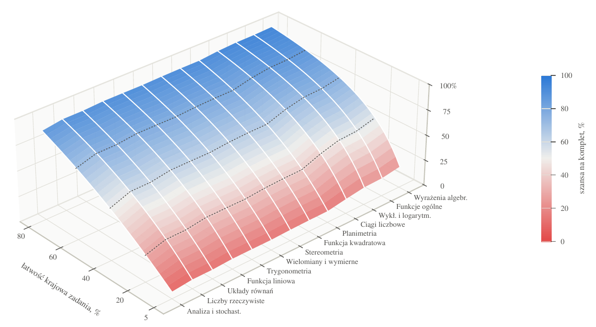

<div align="center">

<picture>
  <source media="(prefers-color-scheme: dark)" srcset="docs/naglowek-ciemny.svg">
  
</picture>

<p>Korepetytor AI do matury rozszerzonej z matematyki, działający w Claude Code.</p>

<a href="LICENSE"></a>


</div>

<br>

<p align="center">
  
</p>
<p align="center"><sub>Arkusz i raport wygenerowane przez <code>matura.py</code>. Raport na danych symulowanych.</sub></p>

## O projekcie

matura-tutor zamienia Claude'a w korepetytora, który prowadzi ucznia od diagnozy do matury. Ma bazę 4608 zadań z arkuszy CKE z lat 2002–2026, składa z nich arkusze PDF pod konkretne luki, sprawdza zdjęcia rozwiązań według zasad oceniania CKE i co tydzień wydaje raport z prognozą wyniku.

- **Dobór zadań.** Każde zadanie jest opisane wektorem 160 wymiarów. System wybiera zadania najbliższe temu, czego uczeń jeszcze nie umie, w trudności, przy której skuteczność zostaje w przedziale 60–80%.
- **Sprawdzanie.** Punkty liczone jak na egzaminie. Przy błędzie Claude zadaje jedno pytanie naprowadzające zamiast pokazywać gotowe rozwiązanie.
- **Dziennik błędów.** Każdy błąd zostaje zapisany jako reguła „Jeśli …, to …” i wraca w rozgrzewce w odstępach od 1 do 28 dni. Zadanie z błędem wraca po trzech dniach jako bliźniak.
- **Raport tygodniowy.** PDF z LaTeX-a: opanowanie działów z przedziałem niepewności, porównanie z wynikami kraju, prognoza na maturach 2023–2026.
- **Plan na 29 tygodni.** Kolejka bloków działów zakończona pełnymi arkuszami. Co dwa tygodnie przegląd, najwyżej jedna zmiana.

## Szybki start

```bash
git clone https://github.com/NelexstarMain/matura-tutor
cd matura-tutor
claude
```

Przy starcie sesji hook uruchamia `python3 matura.py start`. Polecenie instaluje zależności, tworzy lokalną bazę `matura.db`, sprawdza system i wypisuje kolejny krok. Nowego ucznia Claude najpierw pyta o datę matury, czas na naukę i słabe działy, a potem składa arkusz diagnostyczny.

> [!TIP]
> W innym kliencie wystarczy napisać: *Uruchom `python3 matura.py start` i zacznij.*

## Jak przebiega lekcja

1. **Arkusz.** Claude składa PDF z zadaniami dobranymi pod luki ucznia i pięcioma pytaniami rozgrzewki z dziennika błędów.
2. **Rozwiązanie.** Uczeń rozwiązuje na kartce, z zegarem, i wysyła zdjęcia.
3. **Sprawdzanie.** Punkty według zasad CKE, typ każdego błędu i nowa reguła do dziennika.
4. **Raport.** Raz w tygodniu: opanowanie działów, prognoza wyniku i plan na następny tydzień.

Każda lekcja uzupełnia profil ucznia, więc kolejny arkusz jest dobrany dokładniej.

## Raport tygodniowy

<p align="center">
  
</p>
<p align="center"><sub>Szansa na komplet punktów w funkcji działu i łatwości krajowej zadania. Kolor czerwony oznacza szansę poniżej 50%.</sub></p>

Raport ma około ośmiu stron: aktywność w tygodniu, profil umiejętności, wynik na tle kraju, analizę błędów, kolejkę powtórek, harmonogram i komentarz korepetytora. Na prośbę ucznia powstaje też raport z całej historii i atlas bazy zadań.

## Struktura

```text
matura-tutor/
├── matura.py              cały kod i jedyne wejście CLI
├── PROCEDURY.md           arkusz, sprawdzanie, rozgrzewka, raport, przegląd planu
├── CLAUDE.md              instrukcja ładowana na start sesji
├── .claude/               hook startowy i skill matura-master
├── docs/DOKUMENTACJA.md   zasady, mapa folderu, CLI, funkcje, pułapki
├── dane/                  baza wzorcowa, harmonogram, listy pomocnicze
└── baza_obrazy/           obrazy zadań z arkuszy CKE
```

<details>
<summary><b>Najczęstsze polecenia</b></summary>

<br>

| Polecenie | Co robi |
| --- | --- |
| `python3 matura.py start` | przygotowanie sesji i stan ucznia |
| `python3 matura.py kontrola` | test systemu i mapy folderu (około 5 s) |
| `python3 matura.py petla dzis` | fiszki do powtórki na dziś |
| `python3 matura.py raport` | raport tygodniowy PDF |
| `python3 matura.py raport --symulacja` | raport na danych testowych |

Pełna lista w [dokumentacji](docs/DOKUMENTACJA.md#cli).

</details>

## Wymagania

- Python 3.10 lub nowszy; pakiety z `requirements.txt` instaluje `start`
- `poppler-utils` do podglądu stron PDF
- TeX Live z obsługą języka polskiego do raportów: `bash dane/instaluj_tex.sh`

## Prywatność i licencja

Dane ucznia (`matura.db`, `notatki/`, `arkusze/`, `raporty/`) zostają na jego komputerze i są wyłączone z gita. Kod, dokumentacja i skill są udostępnione na licencji [MIT](LICENSE). Zadania i obrazy pochodzą z arkuszy CKE, służą do nauki i nie są objęte tą licencją.
