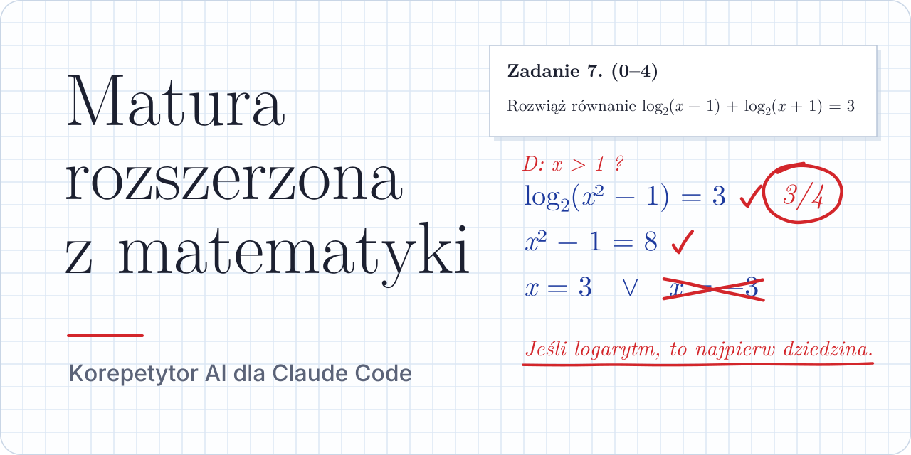
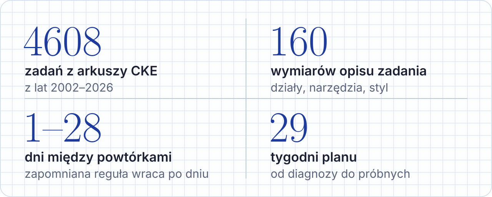
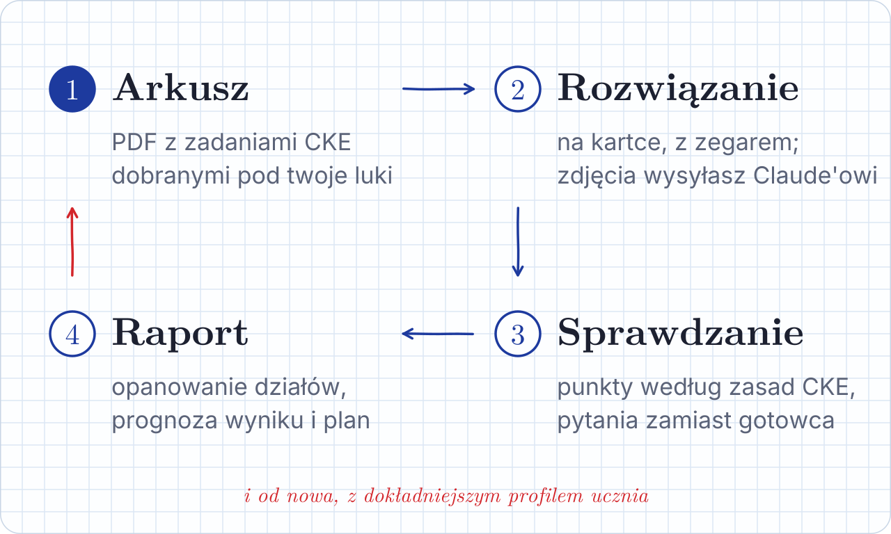
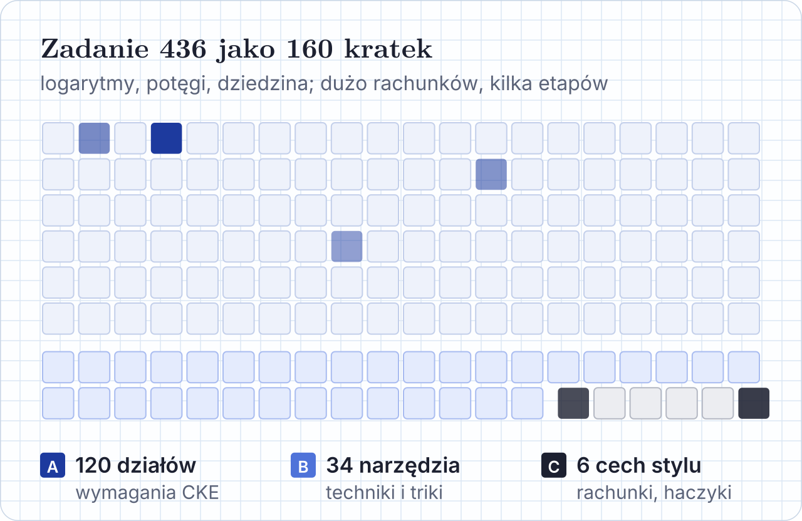
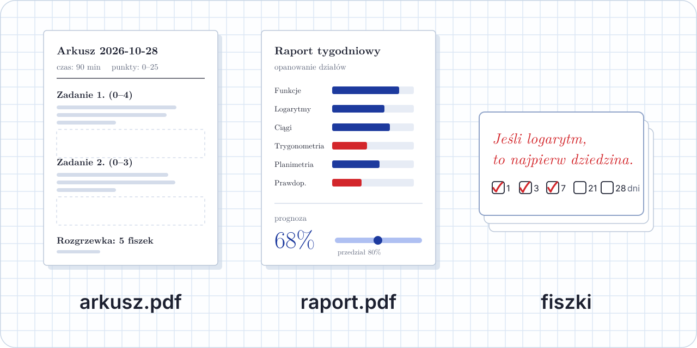

<p align="center">
  
</p>

<h1 align="center">matura-tutor</h1>

<p align="center">
  
</p>

<p align="center">
  Dobiera zadania z arkuszy CKE pod twoje luki, sprawdza rozwiązania jak egzaminator<br>
  i pamięta każdy błąd, aż przestanie wracać.
</p>

<p align="center">
  <a href="LICENSE"></a>
  
  
  
</p>

<p align="center">
  <a href="#start"><b>Start</b></a>&nbsp;&nbsp;&nbsp;
  <a href="#jak-wyglada-lekcja"><b>Lekcja</b></a>&nbsp;&nbsp;&nbsp;
  <a href="#jak-dobiera-zadania"><b>Dobór zadań</b></a>&nbsp;&nbsp;&nbsp;
  <a href="#co-dostajesz"><b>Co dostajesz</b></a>&nbsp;&nbsp;&nbsp;
  <a href="docs/DOKUMENTACJA.md"><b>Dokumentacja</b></a>
</p>

<br>

<p align="center">
  
</p>

## Start

```bash
git clone https://github.com/NelexstarMain/matura-tutor
cd matura-tutor
claude
```

To wszystko. Przy starcie sesji hook uruchamia `python3 matura.py start`: instaluje zależności, tworzy bazę `matura.db` z wzorca, sprawdza system i wypisuje, co dalej. Nowego ucznia Claude najpierw pyta o datę matury, czas w tygodniu i słabe działy, po jednym pytaniu naraz.

> [!TIP]
> Poza Claude Code wystarczy napisać: *Uruchom `python3 matura.py start` i zacznij.*

## Jak wygląda lekcja

<p align="center">
  
</p>

Arkusz zaczyna się od pięciominutowej rozgrzewki z reguł, które ostatnio ci uciekały. Rozwiązujesz na kartce, z zegarem, i wysyłasz zdjęcia. Claude liczy punkty według zasad CKE, a przy błędzie zadaje jedno pytanie naprowadzające zamiast pokazywać gotowe rozwiązanie. Każdy błąd trafia do dziennika jako reguła „Jeśli …, to …”, z której powstaje fiszka.

## Jak dobiera zadania

<p align="center">
  
</p>

Każde z 4608 zadań jest opisane 160 liczbami: 120 działów z wymagań CKE, 34 narzędzia (np. usuwanie niewymierności) i 6 cech stylu (rachunki, haczyki, wieloetapowość). Twoje próby układają się w taki sam wektor, więc system szuka zadań najbliższych temu, czego jeszcze nie umiesz, w trudności dopasowanej do bieżącej skuteczności. Cel to 60–80% poprawnych odpowiedzi: po porażce trochę łatwiej, po sukcesie trudniej.

Zadanie z błędem odpoczywa trzy dni, potem wraca jego bliźniak, czyli inne zadanie o podobnym wektorze. Reguły z dziennika wracają w rozgrzewce w odstępach od 1 do 28 dni, za każdym razem w innej formie.

## Co dostajesz

<p align="center">
  
</p>

| | |
| --- | --- |
| **Arkusz PDF** | zadania z bazy CKE, czas, punktacja i rozgrzewka z twoich fiszek |
| **Wynik i analiza** | punkty za każde zadanie, typ błędu i reguła do zapamiętania |
| **Raport tygodniowy** | PDF z LaTeX-a: opanowanie działów z przedziałem niepewności, prognoza wyniku na maturach 2023–2026, plan na następny tydzień |
| **Plan na 29 tygodni** | od diagnozy przez bloki działów do pełnych arkuszy; co dwa tygodnie przegląd i najwyżej jedna zmiana |

## W repozytorium

```text
matura-tutor/
├── matura.py              cały kod i jedyne wejście CLI
├── PROCEDURY.md           arkusz, sprawdzanie, rozgrzewka, raport, przegląd planu
├── CLAUDE.md              instrukcja ładowana na start sesji
├── .claude/               hook startowy i skill matura-master
├── docs/DOKUMENTACJA.md   zasady, mapa folderu, CLI, funkcje, pułapki
├── dane/                  baza wzorcowa, harmonogram, listy pomocnicze
└── baza_obrazy/           obrazy zadań z arkuszy CKE
```

Najczęstsze polecenia: `python3 matura.py kontrola` (test systemu, około 5 s), `python3 matura.py raport` (raport tygodniowy), `python3 matura.py petla dzis` (fiszki na dziś). Pełna lista w [dokumentacji](docs/DOKUMENTACJA.md#cli).

## Wymagania

- Python 3.10+ (pakiety z `requirements.txt` instaluje `start`)
- `poppler-utils` do podglądu PDF
- TeX Live do raportów: `bash dane/instaluj_tex.sh` (raport wywoła go sam przy pierwszym uruchomieniu)

## Prywatność i licencja

Twoje postępy (`matura.db`, `notatki/`, `arkusze/`, `raporty/`) zostają na twoim komputerze i są w `.gitignore`. Kod, dokumentacja i skill są na licencji [MIT](LICENSE). Zadania i obrazy pochodzą z arkuszy CKE, służą do nauki i nie są objęte tą licencją.

<br>

<p align="center">
  
</p>
