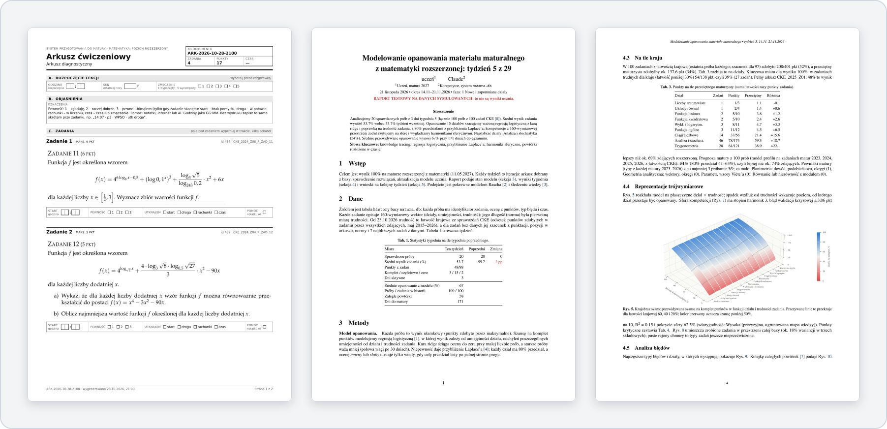
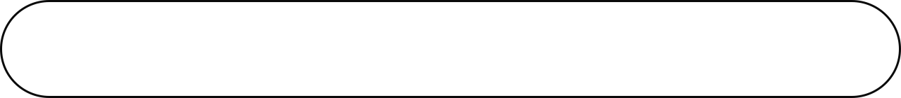

<div align="center">

<br>


<p>Korepetytor AI do matury rozszerzonej z matematyki, działający w Claude Code.</p>

<a href="LICENSE"></a>


</div>

<br>



## Co robi

- **Dobiera zadania** z 4608 zadań CKE (2002–2026) pod luki ucznia.
- **Składa arkusze PDF** z rozgrzewką z własnych błędów.
- **Sprawdza zdjęcia rozwiązań** według zasad CKE, bez podawania gotowców.
- **Pamięta błędy** jako reguły „Jeśli …, to …” i wraca do nich, aż przestaną się powtarzać.
- **Co tydzień wydaje raport** z opanowaniem działów i prognozą wyniku.

## Start

```bash
git clone https://github.com/NelexstarMain/matura-tutor
cd matura-tutor
claude
```

Hook startowy sam instaluje zależności i tworzy bazę. Claude zadaje kilka pytań wstępnych i składa arkusz diagnostyczny.

## Struktura

```text
matura.py      kod i CLI
PROCEDURY.md   kroki lekcji, sprawdzania i raportu
CLAUDE.md      instrukcja dla Claude
.claude/       hook startowy i skill
docs/          dokumentacja techniczna
dane/          baza wzorcowa i harmonogram
baza_obrazy/   obrazy zadań
```

Szczegóły: [docs/DOKUMENTACJA.md](docs/DOKUMENTACJA.md)

## Wymagania

Python 3.10+, `poppler-utils`, do raportów TeX Live (`bash dane/instaluj_tex.sh`).

## Licencja

Kod na licencji [MIT](LICENSE). Zadania pochodzą z arkuszy CKE i nie są nią objęte. Dane ucznia zostają lokalnie i nie trafiają do gita.

<br>


